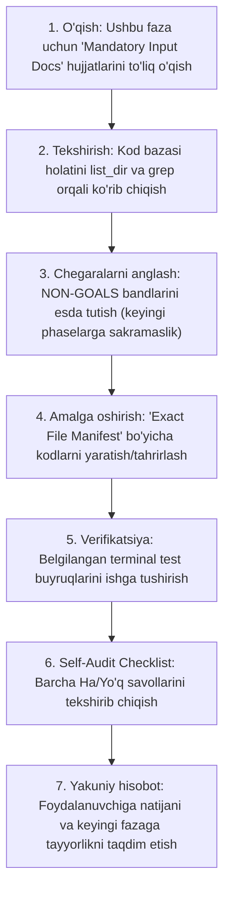

# EduSelf Teacher — Dasturiy Rivojlanish Yo‘l Xaritasi (development_plan.md)
## Anti-Hallucination & Modular Implementation Plan (Phases 00 – 11)

**Loyiha nomi:** EduSelf Teacher — AI & Real-Time Classroom Gamification Platform  
**Hujjat versiyasi:** 1.0.0 (Master Development Plan)  
**Sana:** 15-oktabr 2026  
**Holati:** Tasdiqlangan / Amalga oshirishga tayyor  
**Boshqaruv qoidasi:** Har bir bosqich qat'iy "Anti-Hallucination" (galyutsinatsiyaga qarshi) qoidalari bilan jihozlangan. Kelgusida istalgan AI agentga *"Phase N ni tayyorlagin"* buyrug‘i berilganda, u faqat shu bosqich doirasidagi hujjatlarni o‘qib, belgilangan fayllar manifesti bo‘yicha kod yozadi va chegaralardan chiqmaydi.

---

## 📑 Mundarija

1. [AI Agent Ijro Protokoli (Agent Execution Protocol)](#1-ai-agent-ijro-protokoli-agent-execution-protocol)
2. [Bosqichlar Ketma-ketligi Umumiy Xaritasi](#2-bosqichlar-ketma-ketligi-umumiy-xaritasi)
3. [Phase 00: Muhit, Docker va Django Monolit Yadroviy Tuzilmasi](#phase-00-muhit-docker-va-django-monolit-yadroviy-tuzilmasi)
4. [Phase 01: Foydalanuvchilar, RBAC va Ijtimoiy Autentifikatsiya (Google & Telegram)](#phase-01-foydalanuvchilar-rbac-va-ijtimoiy-autentifikatsiya-google--telegram)
5. [Phase 02: Savollar Registri va Viktorina (Quiz) Boshqaruv Dvigateli](#phase-02-savollar-registri-va-viktorina-quiz-boshqaruv-dvigateli)
6. [Phase 03: Real-Time Dvigatel, WebSockets va Xonalar Holat Mashinasi (FSM)](#phase-03-real-time-dvigatel-websockets-va-xonalar-holat-mashinasi-fsm)
7. [Phase 04: O‘yin Rejimlari Katalogi, Ball Hisoblash va Shohsupa (Leaderboard)](#phase-04-oyin-rejimlari-katalogi-ball-hisoblash-va-shohsupa-leaderboard)
8. [Phase 05: Ko‘p Provayderli AI Gateway va BYOK Shifrlash Tizimi](#phase-05-kop-provayderli-ai-gateway-va-byok-shifrlash-tizimi)
9. [Phase 06: O‘qituvchi AI Ish Joyi (Workspace) va Strukturaviy Test Generatsiyasi](#phase-06-oqituvchi-ai-ish-joyi-workspace-va-strukturaviy-test-generatsiyasi)
10. [Phase 07: Model Context Protocol (MCP) Serveri va Tashqi Chatbotlar](#phase-07-model-context-protocol-mcp-serveri-va-tashqi-chatbotlar)
11. [Phase 08: Frontend Interfeys va "EduPlay 3D" Gamifikatsiya Dizayni](#phase-08-frontend-interfeys-va-eduplay-3d-gamifikatsiya-dizayni)
12. [Phase 09: Google Sheets Ikki Tomonlama Sinxronizatsiyasi va Celery Vazifalari](#phase-09-google-sheets-ikki-tomonlama-sinxronizatsiyasi-va-celery-vazifalari)
13. [Phase 10: Xavfsizlik Qat'iylashtiruvi, Tezlik Cheklovlari (Rate Limiting) va OWASP](#phase-10-xavfsizlik-qatiylashtiruvi-tezlik-cheklovlari-rate-limiting-va-owasp)
14. [Phase 11: AWS EC2 Ishlab Chiqarish Muhitiga O‘rnatish, Nginx va Monitoring](#phase-11-aws-ec2-ishlab-chiqarish-muhitiga-ornatish-nginx-va-monitoring)

---

## 1. AI Agent Ijro Protokoli (Agent Execution Protocol)

Har qanday AI agent loyiha ustida ishlashni boshlaganda (masalan, foydalanuvchi *"Phase 1 ni tayyorlagin"* deganida), **majburiy tartibda** quyidagi 7 bosqichli tartib-qoidaga amal qilishi SHART:



> [!CAUTION]
> **Galyutsinatsiyani Oldini Olish Qoidalari:**
> 1. Belgilangan `Exact Target Files` ro‘yxatidan tashqarida o‘zboshimchalik bilan fayl yaratish taqiqlanadi.
> 2. `Strictly Out of Scope (Non-Goals)` ro‘yxatidagi birorta ham funksionallikni ushbu bosqichda yozishga urinmang (masalan, Phase 1 da WebSocket yoki AI kodini yozmang).
> 3. Kod yozishdan oldin har doim ko‘rsatilgan `.docs/` hujjatlarini o‘qing.

---

## 2. Bosqichlar Ketma-ketligi Umumiy Xaritasi

```text
[Phase 00: Core & Docker] ──► [Phase 01: Auth & RBAC] ──► [Phase 02: Question Registry & Quiz]
                                                                     │
     ┌───────────────────────────────────────────────────────────────┘
     ▼
[Phase 03: Real-Time & WebSockets] ──► [Phase 04: Game Modes & Scoring]
                                                    │
     ┌──────────────────────────────────────────────┘
     ▼
[Phase 05: Multi-Provider AI Gateway] ──► [Phase 06: AI Workspace & Diff Engine]
                                                    │
     ┌──────────────────────────────────────────────┘
     ▼
[Phase 07: MCP Server & Tools] ──► [Phase 08: Frontend MVT & EduPlay 3D]
                                                    │
     ┌──────────────────────────────────────────────┘
     ▼
[Phase 09: Google Sheets & Celery] ──► [Phase 10: Security & Rate Limiting]
                                                    │
     ┌──────────────────────────────────────────────┘
     ▼
[Phase 11: AWS EC2 Deployment & Production Launch]
```

---

## Phase 00: Muhit, Docker va Django Monolit Yadroviy Tuzilmasi

- **Faza ID:** `PHASE-00`
- **Domen:** Infratuzilma, Yadro Sozlamalari, Ma'lumotlar Bazasi va Konteynerlar
- **Bog‘liqlik (Prerequisites):** Yo‘q (Boshlang‘ich faza)

### 1. O‘qilishi Majburiy Hujjatlar (Mandatory Input Documents)
1. [Backend.md](file:///c:/Users/Asus/Desktop/teacher-eduself-mcp/.docs/Backend.md) — 1-bo‘lim (Kirish va Backend Loyiha Strukturasi, papkalar daraxti).
2. [TECH_STACK.md](file:///c:/Users/Asus/Desktop/teacher-eduself-mcp/.docs/TECH_STACK.md) — Python 3.12, Django 5.1+, PostgreSQL 16, Redis 7.2, Daphne talablari.
3. [Architecture.md](file:///c:/Users/Asus/Desktop/teacher-eduself-mcp/.docs/Architecture.md) — Modulli monolit arxitekturasi.

### 2. Yaratiladigan Fayllar Manifesti (Exact File Manifest)
```text
teacher-eduself-mcp/
├── core/
│   ├── settings/
│   │   ├── __init__.py
│   │   ├── base.py
│   │   ├── local.py
│   │   └── production.py
│   ├── __init__.py
│   ├── asgi.py
│   ├── wsgi.py
│   ├── celery.py
│   └── urls.py
├── apps/
│   └── __init__.py
├── .env.example
├── .gitignore
├── Dockerfile.backend
├── docker-compose.yml
├── requirements.txt
├── pytest.ini
└── manage.py
```

### 3. Qamrov Chegaralari (Scope Boundaries)
- ✅ **IN SCOPE:**
  - Django 5.1+ loyihasini modulli sozlamalar (`base.py`, `local.py`, `production.py`) bilan sozlash.
  - PostgreSQL 16 va Redis 7.2 uchun `docker-compose.yml` va `.env.example`.
  - Daphne ASGI serverining boshlang‘ich `asgi.py` sozlamasi.
  - Celery 5.4 broker va natijalar sozlamalari (`celery.py`).
  - Pytest va Django test konfiguratsiyasi (`pytest.ini`).
- 🚫 **OUT OF SCOPE (NON-GOALS):**
  - Foydalanuvchilar modeli yoki autentifikatsiya logikasini yozish (Phase 01 da qilinadi).
  - WebSocket consumerlarini yozish (Phase 03 da qilinadi).
  - AWS EC2 ishlab chiqarish skriptlarini yozish (Phase 11 da qilinadi).

### 4. Bosqichma-bosqich Vazifalar
1. `requirements.txt` faylini yaratish (Django, djangorestframework, channels, channels-redis, psycopg2-binary, celery, redis, pytest-django, python-dotenv).
2. `core/settings/` paketini ajratish (`base.py` dagi umumiy ilovalar va middleware, `local.py` dagi debug va DB).
3. `core/celery.py` ilovasini ishga tushirish.
4. `docker-compose.yml` faylida PostgreSQL 16 va Redis xizmatlarini ta'riflash.
5. `manage.py` va `pytest.ini` sozlamalarini yakunlash.

### 5. Verifikatsiya Buyruqlari
```bash
python manage.py check
pytest
docker-compose config
```
*Kutilayotgan natija:* Hech qanday xatoliksiz `System check identified no issues (0 silenced)` chiqishi.

### 6. Self-Audit Checklist
- [ ] `core/settings/base.py` barcha muhitlar uchun ajratilganmi?
- [ ] PostgreSQL va Redis uchun Docker Compose to'g'ri sozlanganmi?
- [ ] `manage.py check` xatosiz o‘tdimi?

---

## Phase 01: Foydalanuvchilar, RBAC va Ijtimoiy Autentifikatsiya (Google & Telegram)

- **Faza ID:** `PHASE-01`
- **Domen:** Autentifikatsiya, Foydalanuvchilar Profili, Tashkilotlar va Huquqlar (RBAC)
- **Bog‘liqlik (Prerequisites):** `PHASE-00` muvaffaqiyatli yakunlangan bo‘lishi shart.

### 1. O‘qilishi Majburiy Hujjatlar (Mandatory Input Documents)
1. [Backend.md](file:///c:/Users/Asus/Desktop/teacher-eduself-mcp/.docs/Backend.md) — 2.1-bo‘lim (User va Organization modellari) hamda 3-bo‘lim (Google OAuth & Telegram Widget).
2. [SECURITY.md](file:///c:/Users/Asus/Desktop/teacher-eduself-mcp/.docs/SECURITY.md) — 1-bo‘lim (Autentifikatsiya va Sessiyalar boshqaruvi).
3. [user_stories.md](file:///c:/Users/Asus/Desktop/teacher-eduself-mcp/.docs/user_stories.md) — US-01 (Ro‘yxatdan o‘tish va kirish).

### 2. Yaratiladigan Fayllar Manifesti (Exact File Manifest)
```text
apps/authentication/
├── __init__.py
├── admin.py
├── apps.py
├── models.py                   # User, Organization, TeacherProfile
├── views.py                    # login, logout, telegram_auth_callback, google_auth
├── services.py                 # Telegram HMAC-SHA256 validator, Google OAuth token exchange
├── permissions.py              # IsTeacher, IsSchoolAdmin, IsSystemAdmin
├── urls.py
└── tests/
    ├── __init__.py
    ├── test_models.py
    └── test_telegram_auth.py
```

### 3. Qamrov Chegaralari (Scope Boundaries)
- ✅ **IN SCOPE:**
  - `User` modeli (UUID primary key, `AbstractUser`, `role`, `telegram_id`, `preferred_locale`).
  - `Organization` modeli (maktablar va oylik AI token limiti).
  - Telegram Widget callback logikasi (HMAC-SHA256 tekshiruvi, 24 soatlik muddati tekshirish).
  - Google OAuth2 (OpenID Connect orqali email va profil ma'lumotlarini qabul qilish).
  - Standart sessiyaga asoslangan login/logout va RBAC huquqlar filtri.
- 🚫 **OUT OF SCOPE (NON-GOALS):**
  - Viktorina yaratish yoki savollar modeli (Phase 02).
  - MCP autentifikatsiya tokenlari yoki API kalitlar (Phase 07).
  - Frontend sahifalari (Phase 08).

### 4. Bosqichma-bosqich Vazifalar
1. `apps/authentication/models.py` da `Organization` va `User` modellarini yaratish.
2. `core/settings/base.py` da `AUTH_USER_MODEL = 'authentication.User'` sozlamasini kiritish.
3. `apps/authentication/services.py` da Telegram hash tekshiruvchi funksiya (`check_telegram_hash`) va Google OAuth adapterini yozish.
4. `apps/authentication/views.py` va `urls.py` marshrutlarini ulash.
5. `test_telegram_auth.py` va `test_models.py` orqali unit testlar yozish.

### 5. Verifikatsiya Buyruqlari
```bash
python manage.py makemigrations authentication
python manage.py migrate
pytest apps/authentication/tests/
```
*Kutilayotgan natija:* Barcha testlar muvaffaqiyatli o‘tishi (`passed`), Telegram soxta hash yuborilganda `403 Forbidden` qaytishi.

### 6. Self-Audit Checklist
- [ ] `AUTH_USER_MODEL` loyiha boshidan to‘g‘ri ko‘rsatilganmi?
- [ ] Telegram HMAC-SHA256 algoritmi xavfsizlik talablariga javob beradimi?
- [ ] Parollar xavfsiz heshlanmoqdami va testlar 100% yashilmi?

---

## Phase 02: Savollar Registri va Viktorina (Quiz) Boshqaruv Dvigateli

- **Faza ID:** `PHASE-02`
- **Domen:** Viktorina Dvigateli, 29 xil Savol Turlari Registri, Versiyalash va Validatsiya
- **Bog‘liqlik (Prerequisites):** `PHASE-01` yakunlangan bo‘lishi shart.

### 1. O‘qilishi Majburiy Hujjatlar (Mandatory Input Documents)
1. [QUIZ_ENGINE.md](file:///c:/Users/Asus/Desktop/teacher-eduself-mcp/.docs/engine/QUIZ_ENGINE.md) — Viktorinalar arxitekturasi va savol holatlari.
2. [QUESTION_TYPES.md](file:///c:/Users/Asus/Desktop/teacher-eduself-mcp/.docs/engine/QUESTION_TYPES.md) — 29 xil savol formati va JSON sxemalari.
3. [Backend.md](file:///c:/Users/Asus/Desktop/teacher-eduself-mcp/.docs/Backend.md) — 2.2-bo‘lim (`Quiz` va `Question` modellari).

### 2. Yaratiladigan Fayllar Manifesti (Exact File Manifest)
```text
apps/questions_registry/
├── __init__.py
├── base.py                     # BaseQuestionType abstrakt sinfi
├── registry.py                 # QuestionTypeRegistry (plaginlar ro'yxati)
├── exceptions.py
├── types/
│   ├── __init__.py
│   ├── single_choice.py
│   ├── multiple_choice.py
│   ├── true_false.py
│   ├── ordering.py
│   ├── categorization.py
│   ├── cloze.py
│   └── open_short.py
└── tests/
    └── test_registry.py

apps/quizzes/
├── __init__.py
├── admin.py
├── apps.py
├── models.py                   # Quiz, Question, QuizVersion
├── serializers.py
├── services.py                 # QuizCRUD, VersionManager, QuestionValidator
├── views.py
├── urls.py
└── tests/
    └── test_quiz_crud.py
```

### 3. Qamrov Chegaralari (Scope Boundaries)
- ✅ **IN SCOPE:**
  - `Quiz` modeli (mavzu, sinf, til, holat: draft/published/archived, versiya).
  - `Question` modeli (`type`, `prompt`, `options`, `correct_answer` JSONB, `is_locked`, `points`, `time_limit`).
  - Plaginli `QuestionTypeRegistry` — har bir savol turi o‘zining `validate_payload` va `check_answer` metodlariga ega bo‘lishi.
  - Savollarni tahrirlashdan qulflash (`is_locked`) va versiyalash mexanizmi.
- 🚫 **OUT OF SCOPE (NON-GOALS):**
  - Jonli xonalar ochish yoki PIN kod orqali o‘ynash (Phase 03).
  - AI orqali savollar yaratish (Phase 06).
  - Google Sheets sinxronizatsiyasi (Phase 09).

### 4. Bosqichma-bosqich Vazifalar
1. `apps/questions_registry/base.py` da `BaseQuestionType` interfeysini yozish.
2. Dastlabki asosiy 7 ta savol turi (single_choice, multiple_choice, true_false, ordering, categorization, cloze, open_short) plaginlarini yaratish va ro‘yxatga olish.
3. `apps/quizzes/models.py` da `Quiz` va `Question` modellarini yaratish.
4. `apps/quizzes/services.py` da savol qo‘shishda uning `options` va `correct_answer` maydonlarini tegishli registrdagi plagin orqali tekshirish.
5. Unit testlar yozish (noto‘g‘ri formatdagi savol berilganda `ValidationError` chiqishi tekshiriladi).

### 5. Verifikatsiya Buyruqlari
```bash
python manage.py makemigrations quizzes
python manage.py migrate
pytest apps/questions_registry/tests/ apps/quizzes/tests/
```
*Kutilayotgan natija:* 100% testlar o‘tishi, savol yaratishda JSONB validatsiyasining ishlashi.

### 6. Self-Audit Checklist
- [ ] Yangi savol turi qo‘shilganda yadroviy model o‘zgarmasdan plagin qo‘shilishi mumkinmi?
- [ ] `correct_answer` maydoni talaba interfeysiga tasodifan chiqib ketmasligi uchun serializerda himoyalanganmi?

---

## Phase 03: Real-Time Dvigatel, WebSockets va Xonalar Holat Mashinasi (FSM)

- **Faza ID:** `PHASE-03`
- **Domen:** Django Channels, WebSocket Aloqasi, Sessiya FSM, PIN/QR va Qayta Ulanish
- **Bog‘liqlik (Prerequisites):** `PHASE-01` va `PHASE-02` yakunlangan bo‘lishi shart.

### 1. O‘qilishi Majburiy Hujjatlar (Mandatory Input Documents)
1. [LIVE_SESSION.md](file:///c:/Users/Asus/Desktop/teacher-eduself-mcp/.docs/engine/LIVE_SESSION.md) — Jonli sessiya bosqichlari (Lobby, Active, Paused, Ended).
2. [REALTIME_PROTOCOL.md](file:///c:/Users/Asus/Desktop/teacher-eduself-mcp/.docs/engine/REALTIME_PROTOCOL.md) — WebSocket protokoli va xabar paketlari.
3. [EVENTS.md](file:///c:/Users/Asus/Desktop/teacher-eduself-mcp/.docs/engine/EVENTS.md) — Real-time eventlar spetsifikatsiyasi.
4. [RECONNECTION.md](file:///c:/Users/Asus/Desktop/teacher-eduself-mcp/.docs/engine/RECONNECTION.md) — Qayta ulanish strategiyasi.
5. [Backend.md](file:///c:/Users/Asus/Desktop/teacher-eduself-mcp/.docs/Backend.md) — 4-bo‘lim (ClassroomGameConsumer).

### 2. Yaratiladigan Fayllar Manifesti (Exact File Manifest)
```text
core/
├── routing.py                  # Channels WebSocket URL routing
apps/live_sessions/
├── __init__.py
├── admin.py
├── apps.py
├── models.py                   # LiveSession, Participant, AnswerSubmission
├── consumers.py                # ClassroomGameConsumer, HostGameConsumer
├── fsm.py                      # SessionStateMachine (draft->lobby->active->end)
├── services.py                 # RoomCodeGenerator (6 belgi), ReconnectionManager
├── urls.py
└── tests/
    ├── __init__.py
    ├── test_fsm.py
    └── test_consumers.py
```

### 3. Qamrov Chegaralari (Scope Boundaries)
- ✅ **IN SCOPE:**
  - `LiveSession` (room_code, status, settings) va `Participant` (nickname, anonymous_token, score).
  - Django Channels WebSocket iste'molchisi (`ClassroomGameConsumer`).
  - Xona FSM holatlari boshqaruvi (`lobby`, `active`, `question_open`, `question_closed`, `reveal`, `podium`, `ended`).
  - Redis channel layer orqali xona guruhlariga (`room_{code}`) real-time xabar tarqatish.
  - Qayta ulanish (reconnection token) orqali uzilib qolgan o‘quvchining sessiyasini tiklash.
- 🚫 **OUT OF SCOPE (NON-GOALS):**
  - O‘yin rejimlarining maxsus mini-o‘yinlari (Phase 04).
  - AI chat agentini sessiyaga ulash (Phase 06).
  - Ovoz effektlari va brauzer UI (Phase 08).

### 4. Bosqichma-bosqich Vazifalar
1. `core/routing.py` da `ws/session/<room_code>/` yo‘nalishini ro‘yxatdan o‘tkazish.
2. `apps/live_sessions/models.py` da `LiveSession` va `Participant` modellarini yaratish.
3. `apps/live_sessions/fsm.py` da sessiya holatlari o‘tishini xavfsiz boshqaruvchi FSM sinfini yozish.
4. `apps/live_sessions/consumers.py` da o‘quvchilar ulanishi, join hodisasi, javob qabul qilish va natija e'lon qilishni yozish.
5. `pytest-asyncio` va Channels `WebsocketCommunicator` orqali real-time testlar yozish.

### 5. Verifikatsiya Buyruqlari
```bash
python manage.py makemigrations live_sessions
python manage.py migrate
pytest apps/live_sessions/tests/
```
*Kutilayotgan natija:* WebSocket ulanish, xabar almashish va FSM holat o‘zgarishlari testlardan 100% muvaffaqiyatli o‘tishi.

### 6. Self-Audit Checklist
- [ ] Xona kodi 6 ta belgidan iborat takrorlanmas unikal qilib generatsiya qilinadimi?
- [ ] Javob yuborilganda server vaqti tekshirilib, muddati o‘tgan javoblar rad etiladimi?
- [ ] Server-authoritative tamoyiliga qat'iy rioya qilinganmi?

---

## Phase 04: O‘yin Rejimlari Katalogi, Ball Hisoblash va Shohsupa (Leaderboard)

- **Faza ID:** `PHASE-04`
- **Domen:** O‘yin Rejimlari Plaginlari, Ball va Tezlik Bonusi Algoritmi, Jamoalar, Redis Leaderboard
- **Bog‘liqlik (Prerequisites):** `PHASE-03` yakunlangan bo‘lishi shart.

### 1. O‘qilishi Majburiy Hujjatlar (Mandatory Input Documents)
1. [GAME_MODES.md](file:///c:/Users/Asus/Desktop/teacher-eduself-mcp/.docs/engine/GAME_MODES.md) — 40+ o‘yin rejimlari katalogi.
2. [GAME_PLUGIN_ARCHITECTURE.md](file:///c:/Users/Asus/Desktop/teacher-eduself-mcp/.docs/engine/GAME_PLUGIN_ARCHITECTURE.md) — GameMode plagin arxitekturasi.
3. [SCORING.md](file:///c:/Users/Asus/Desktop/teacher-eduself-mcp/.docs/engine/SCORING.md) — Ball hisoblash va tezlik koeffitsiyenti formulasi.
4. [TEAM_SYSTEM.md](file:///c:/Users/Asus/Desktop/teacher-eduself-mcp/.docs/engine/TEAM_SYSTEM.md) — Jamoalar tizimi va taqsimoti.
5. [LEADERBOARD.md](file:///c:/Users/Asus/Desktop/teacher-eduself-mcp/.docs/engine/LEADERBOARD.md) — Redis Sorted Sets asosidagi shohsupa.

### 2. Yaratiladigan Fayllar Manifesti (Exact File Manifest)
```text
apps/game_engine/
├── __init__.py
├── base.py                     # BaseGameMode abstrakt sinfi
├── registry.py                 # GameModeRegistry
├── scoring.py                  # ScoringEngine (Speed decay, streak multiplier)
├── teams.py                    # TeamAllocator, TeamScoreAggregator
├── leaderboard.py              # RedisLeaderboard (Sorted Sets, top-N, rank delta)
├── modes/
│   ├── __init__.py
│   ├── classic.py              # Standart Kahoot uslubidagi rejim
│   ├── team_battle.py          # Jamoaviy jang rejimi
│   ├── speed_run.py            # Vaqtga qarshi individual poyga
│   └── gold_quest.py           # Blooket uslubidagi sandiqlar va tangalar
└── tests/
    ├── __init__.py
    ├── test_scoring.py
    └── test_leaderboard.py
```

### 3. Qamrov Chegaralari (Scope Boundaries)
- ✅ **IN SCOPE:**
  - `ScoringEngine`: Ball hisoblash formulasi: $S = \text{base} \times [1 - (t / 2T)] \times \text{multiplier}$.
  - Ketma-ket to‘g‘ri javoblar (Streak) uchun bonuslar (1.0x dan 1.5x gacha).
  - Redis `ZADD`, `ZREVRANGE`, `ZREVRANK` yordamida <5ms tezlikdagi shohsupa yuritish.
  - O‘quvchilar o‘rtasidagi o‘rin almashinuvi (`rank_delta`: `▲ +2`, `▼ -1`).
  - Jamoalarni avtomatik yoki qo‘lda shakllantirish va umumiy jamoa ballarini hisoblash.
- 🚫 **OUT OF SCOPE (NON-GOALS):**
  - AI bilan bog‘liq vazifalar (Phase 05 va 06).
  - Canvas yoki murakkab 3D WebGL render (Oddiy HTML/CSS komponentlari Phase 08 da qilinadi).

### 4. Bosqichma-bosqich Vazifalar
1. `apps/game_engine/scoring.py` da ball hisoblash algoritmini amalga oshirish.
2. `apps/game_engine/leaderboard.py` da Redis Sorted Sets bilan ishlovchi shohsupa boshqaruvchisini yozish.
3. `apps/game_engine/base.py` va `registry.py` da o‘yin rejimlari uchun plagin interfeysini qurish.
4. `modes/classic.py` va `modes/team_battle.py` rejimlarini implementatsiya qilish.
5. Unit testlar: tezkor javob bergan o‘quvchi ko‘proq ball olishi va Redis reytingi to‘g‘ri hisoblanishi.

### 5. Verifikatsiya Buyruqlari
```bash
pytest apps/game_engine/tests/
```
*Kutilayotgan natija:* 100% testlar muvaffaqiyatli o‘tishi, ball hisoblashdagi barcha chegara holatlari to‘g‘ri ishlashi.

### 6. Self-Audit Checklist
- [ ] Taymer tugashiga 0.1 soniya qolganda berilgan javob to‘g‘ri ball oladimi?
- [ ] Redis'da reyting yangilanganda tartib buzilmasdan saqlanadimi?

---

## Phase 05: Ko‘p Provayderli AI Gateway va BYOK Shifrlash Tizimi

- **Faza ID:** `PHASE-05`
- **Domen:** AI Provayderlar Adapterlari, Model Routing, BYOK (AES-256-GCM), Xarajatlarni Kuzatish
- **Bog‘liqlik (Prerequisites):** `PHASE-01` yakunlangan bo‘lishi shart.

### 1. O‘qilishi Majburiy Hujjatlar (Mandatory Input Documents)
1. [AI_PROVIDERS.md](file:///c:/Users/Asus/Desktop/teacher-eduself-mcp/.docs/ai/AI_PROVIDERS.md) — 7 ta provayder (OpenAI, Gemini, Claude, DeepSeek, Groq, Qwen, Grok).
2. [AI_ADAPTERS.md](file:///c:/Users/Asus/Desktop/teacher-eduself-mcp/.docs/ai/AI_ADAPTERS.md) — BaseAIAdapter shartnomasi va yagona javob formati.
3. [MODEL_ROUTING.md](file:///c:/Users/Asus/Desktop/teacher-eduself-mcp/.docs/ai/MODEL_ROUTING.md) — Vazifa bo‘yicha model tanlash va kaskadli zaxira (fallback).
4. [BYOK.md](file:///c:/Users/Asus/Desktop/teacher-eduself-mcp/.docs/ai/BYOK.md) — O‘qituvchi o‘z kalitini kiritishi va AES-256-GCM shifrlash.
5. [AI_COSTS.md](file:///c:/Users/Asus/Desktop/teacher-eduself-mcp/.docs/ai/AI_COSTS.md) — Tokenlar byudjeti va xarajat monitoringi.

### 2. Yaratiladigan Fayllar Manifesti (Exact File Manifest)
```text
apps/ai_gateway/
├── __init__.py
├── admin.py
├── apps.py
├── models.py                   # UserApiKey (encrypted), TokenUsageLog
├── base.py                     # BaseAIAdapter abstrakt klassi
├── router.py                   # ModelRouter (tier, latency, cost, fallback)
├── crypto.py                   # AES-256-GCM encrypt/decrypt utilities
├── adapters/
│   ├── __init__.py
│   ├── openai_adapter.py
│   ├── gemini_adapter.py
│   ├── claude_adapter.py
│   ├── groq_adapter.py
│   └── deepseek_adapter.py
└── tests/
    ├── __init__.py
    ├── test_crypto.py
    └── test_adapters.py
```

### 3. Qamrov Chegaralari (Scope Boundaries)
- ✅ **IN SCOPE:**
  - `BaseAIAdapter` yagona abstrakt interfeysi (`complete`, `stream`, `embed`).
  - OpenAI, Gemini, Claude, Groq va DeepSeek uchun to‘liq adapterlar.
  - Provayder uzilib qolganda avtomatik ikkinchisiga o‘tish (Fallback Cascade).
  - O‘qituvchi shaxsiy API kalitlarini AES-256-GCM bilan bazada shifrlab saqlash.
  - Sarflangan har bir kiruvchi/chiquvchi token va narxni `TokenUsageLog` jadvaliga yozish.
- 🚫 **OUT OF SCOPE (NON-GOALS):**
  - Prompt shablonlari yoki savol generatsiyasi logikasi (Phase 06).
  - Tashqi MCP mijozlari bilan muloqot (Phase 07).

### 4. Bosqichma-bosqich Vazifalar
1. `apps/ai_gateway/crypto.py` da AES-256-GCM shifrlash modulini yozish.
2. `apps/ai_gateway/base.py` da `AIResponse`, `UsageMetadata` va `BaseAIAdapter` interfeyslarini tuzish.
3. Adapterlarni yozish (`openai_adapter.py`, `gemini_adapter.py`, `groq_adapter.py`).
4. `router.py` da vazifaga qarab (tezlik, murakkablik, narx) model yo‘naltiruvchisini qurish.
5. Mock API kalitlari bilan adapterlarning xatolikka bardoshliligi bo‘yicha unit testlar yozish.

### 5. Verifikatsiya Buyruqlari
```bash
python manage.py makemigrations ai_gateway
python manage.py migrate
pytest apps/ai_gateway/tests/
```
*Kutilayotgan natija:* Kalitlarni shifrlash/ochish testlari va adapterlarning yagona format qaytarishi tasdiqlanishi.

### 6. Self-Audit Checklist
- [x] API kalitlari bazada ochiq matn (plain text) holatida saqlanmayaptimi?
- [x] Asosiy model (masalan, Claude) 500 xato berganda zaxira model (masalan, Gemini) chaqiriladimi?

---

## Phase 06: O‘qituvchi AI Ish Joyi (Workspace) va Strukturaviy Test Generatsiyasi

- **Faza ID:** `PHASE-06`
- **Domen:** O‘qituvchi Veb AI Agenti, JSON Schema Validatsiya, Diff Engine, Tool Calling
- **Bog‘liqlik (Prerequisites):** `PHASE-02` va `PHASE-05` yakunlangan bo‘lishi shart.

### 1. O‘qilishi Majburiy Hujjatlar (Mandatory Input Documents)
1. [AI_AGENT.md](file:///c:/Users/Asus/Desktop/teacher-eduself-mcp/.docs/ai/AI_AGENT.md) — O‘qituvchi AI agenti xulqi va vazifalari.
2. [AI_QUIZ_GENERATION.md](file:///c:/Users/Asus/Desktop/teacher-eduself-mcp/.docs/ai/AI_QUIZ_GENERATION.md) — Mavzu, darslik yoki matndan test yaratish.
3. [PROMPT_SPEC.md](file:///c:/Users/Asus/Desktop/teacher-eduself-mcp/.docs/ai/PROMPT_SPEC.md) — Tizimli promptlar va versiyalash (v1.0).
4. [AI_OUTPUT_SCHEMAS.md](file:///c:/Users/Asus/Desktop/teacher-eduself-mcp/.docs/ai/AI_OUTPUT_SCHEMAS.md) — Qat'iy JSON Schema spetsifikatsiyasi.
5. [AI_TOOL_CALLING.md](file:///c:/Users/Asus/Desktop/teacher-eduself-mcp/.docs/ai/AI_TOOL_CALLING.md) — Agent platforma ichidagi amallarni chaqirishi.
6. [AI_VALIDATION.md](file:///c:/Users/Asus/Desktop/teacher-eduself-mcp/.docs/ai/AI_VALIDATION.md) — Halos va pedagogik xatolarni tekshirish.

### 2. Yaratiladigan Fayllar Manifesti (Exact File Manifest)
```text
apps/ai_workspace/
├── __init__.py
├── apps.py
├── prompts.py                  # Tizimli prompt shablonlari (v1.0)
├── schemas.py                  # Pydantic va JSON Schema modellari
├── generator.py                # AIQuizGenerator (mavzu, matn, fayl orqali)
├── diff_engine.py              # AIDiffEngine (o'zgarishlarni ko'rsatish)
├── tools.py                    # Agent ichki asboblari (search_questions, lock_question)
├── views.py                    # AI chat streaming va generatsiya API
├── urls.py
└── tests/
    ├── __init__.py
    ├── test_schemas.py
    └── test_generator.py
```

### 3. Qamrov Chegaralari (Scope Boundaries)
- ✅ **IN SCOPE:**
  - O‘qituvchi bergan mavzu yoki matn bo‘yicha 29 ta savol turiga mos JSON generatsiya qilish.
  - JSON Schema asosida AI natijasini qat'iy tekshirish (format buzilsa, avtomatik qayta tuzatish).
  - `AIDiffEngine`: AI savollarni o‘zgartirganda o‘qituvchiga "Oldin / Keyin" ko‘rinishida tasdiqlash uchun chiqarish.
  - O‘qituvchi `is_locked=True` qilgan savollarni AI o‘chira olmasligi yoki o‘zgartira olmasligi kafolati.
- 🚫 **OUT OF SCOPE (NON-GOALS):**
  - Tashqi Telegram/ChatGPT MCP muloqoti (Phase 07).
  - Google Sheets bilan sinxronlash (Phase 09).

### 4. Bosqichma-bosqich Vazifalar
1. `schemas.py` da `GeneratedQuizSchema` va `GeneratedQuestionSchema` ni Pydantic orqali belgilash.
2. `prompts.py` da O‘zbek, Rus va Ingliz tillarida pedagogik qoidalarga asoslangan promptlarni yozish.
3. `generator.py` da `AIQuizGenerator` klassini Gateway orqali ulab, strukturaviy JSON olish.
4. `diff_engine.py` da mavjud test va yangi taklif etilayotgan savollar diffini solishtiruvchi mexanizm qurish.
5. Unit testlar: generatsiya qilingan savollar `QUESTION_TYPES.md` talablariga mos kelishini tekshirish.

### 5. Verifikatsiya Buyruqlari
```bash
pytest apps/ai_workspace/tests/
```
*Kutilayotgan natija:* JSON Schema validatsiyasi 100% muvaffaqiyatli bo‘lishi, noto‘g‘ri JSON kelganda to‘g‘ri xatolik qaytishi.

### 6. Self-Audit Checklist
- [ ] AI qulflangan (`is_locked=True`) savollarni o‘zgartirishga uringanda jarayon bloklanadimi?
- [ ] Barcha to‘g‘ri javoblar va chalg‘ituvchi variantlar pedagogik me'yorga mosmi?

---

## Phase 07: Model Context Protocol (MCP) Serveri va Tashqi Chatbotlar

- **Faza ID:** `PHASE-07`
- **Domen:** Rasmiy Python MCP SDK, SSE va Stdio Transportlari, 12 ta Core MCP Tool, OAuth Scopes
- **Bog‘liqlik (Prerequisites):** `PHASE-01`, `PHASE-02` va `PHASE-03` yakunlangan bo‘lishi shart.

### 1. O‘qilishi Majburiy Hujjatlar (Mandatory Input Documents)
1. [MCP_ARCHITECTURE.md](file:///c:/Users/Asus/Desktop/teacher-eduself-mcp/.docs/mcp/MCP_ARCHITECTURE.md) — MCP server arxitekturasi va mijozlar.
2. [MCP_SERVER.md](file:///c:/Users/Asus/Desktop/teacher-eduself-mcp/.docs/mcp/MCP_SERVER.md) — Serverning ishga tushishi va transportlari.
3. [MCP_TOOLS.md](file:///c:/Users/Asus/Desktop/teacher-eduself-mcp/.docs/mcp/MCP_TOOLS.md) — 12 ta rasmiy asboblar (Tools) spetsifikatsiyasi.
4. [MCP_RESOURCES.md](file:///c:/Users/Asus/Desktop/teacher-eduself-mcp/.docs/mcp/MCP_RESOURCES.md) — Resurslar va tayyor promptlar.
5. [MCP_AUTH.md](file:///c:/Users/Asus/Desktop/teacher-eduself-mcp/.docs/mcp/MCP_AUTH.md) va [MCP_SCOPES.md](file:///c:/Users/Asus/Desktop/teacher-eduself-mcp/.docs/mcp/MCP_SCOPES.md) — OAuth, hisob bog‘lash va ruxsatlar.

### 2. Yaratiladigan Fayllar Manifesti (Exact File Manifest)
```text
apps/mcp_server/
├── __init__.py
├── apps.py
├── server.py                   # MCP server nusxasi (mcp Python SDK)
├── auth.py                     # API Token va Bearer OAuth tekshiruvi
├── scopes.py                   # Scope tekshiruvchi dekoratorlar
├── transports/
│   ├── __init__.py
│   ├── stdio.py                # Stdio transporti (CLI / Claude Desktop uchun)
│   └── sse.py                  # SSE transporti (HTTP / Remote Chatbotlar uchun)
├── tools/
│   ├── __init__.py
│   ├── quiz_tools.py           # list_quizzes, get_quiz, create_quiz, update_quiz
│   ├── session_tools.py        # start_live_session, get_session_status, end_session
│   └── analytics_tools.py      # get_quiz_analytics, export_results
└── tests/
    ├── __init__.py
    ├── test_mcp_tools.py
    └── test_mcp_auth.py
```

### 3. Qamrov Chegaralari (Scope Boundaries)
- ✅ **IN SCOPE:**
  - Rasmiy `mcp` Python SDK yordamida FastMCP / Server nusxasini qurish.
  - Claude Desktop va boshqa lokal klientlar uchun `stdio` orqali ishlash imkoniyati.
  - Veb mijozlar va masofaviy chatbotlar uchun `SSE (Server-Sent Events)` endpointi (`/mcp/sse`).
  - 12 ta standart MCP Tools (viktorinalarni boshqarish, jonli sessiyani boshlash, natijalarni olish).
  - Token orqali autentifikatsiya va `quizzes:read`, `quizzes:write`, `session:host` ruxsatlar tekshiruvi.
- 🚫 **OUT OF SCOPE (NON-GOALS):**
  - Foydalanuvchi interfeysini bezash (Phase 08).
  - MCP tool chaqiruvida backend ruxsatlarini aylanib o‘tishga yo‘l qo‘ymaslik.

### 4. Bosqichma-bosqich Vazifalar
1. `mcp` kutubxonasini sozlash va `server.py` da server instansiyasini e'lon qilish.
2. `tools/quiz_tools.py` da `list_quizzes`, `create_quiz` asboblarini backend xizmatlariga ulash.
3. `tools/session_tools.py` da `start_live_session` va `end_session` asboblarini ulash.
4. `transports/sse.py` orqali Django view ichida SSE oqimini yo‘lga qo‘yish.
5. Unit testlar: har bir tool to‘g‘ri kiritish parametrlarini qabul qilishi va ruxsatsiz tokenlar rad etilishini tekshirish.

### 5. Verifikatsiya Buyruqlari
```bash
pytest apps/mcp_server/tests/
python -m apps.mcp_server.transports.stdio --help
```
*Kutilayotgan natija:* MCP tools ro‘yxati to‘liq chaqirilishi va testlardan xatosiz o‘tishi.

### 6. Self-Audit Checklist
- [ ] MCP orqali boshqa o‘qituvchining testini ko‘rish yoki o‘zgartirish bloklanganmi?
- [ ] SSE transporti uzoq vaqt uzilmasdan ishlay oladimi?

---

## Phase 08: Frontend Interfeys va "EduPlay 3D" Gamifikatsiya Dizayni

- **Faza ID:** `PHASE-08`
- **Domen:** Django MVT Shablonlari, Bento Grid, "EduPlay 3D" Claymorphism, Web Audio API Sintezatori
- **Bog‘liqlik (Prerequisites):** `PHASE-01`, `PHASE-02` va `PHASE-03` yakunlangan bo‘lishi shart.

### 1. O‘qilishi Majburiy Hujjatlar (Mandatory Input Documents)
1. [DESIGN_SYSTEM.md](file:///c:/Users/Asus/Desktop/teacher-eduself-mcp/.docs/ui/DESIGN_SYSTEM.md) — "EduPlay 3D" tokenlari, ranglar, shriftlar va radiuslar.
2. [COMPONENTS.md](file:///c:/Users/Asus/Desktop/teacher-eduself-mcp/.docs/ui/COMPONENTS.md) — Komponentlar spetsifikatsiyasi (Pill, BentoCard, Podium, Modal).
3. [UI_UX_SPEC.md](file:///c:/Users/Asus/Desktop/teacher-eduself-mcp/.docs/ui/UI_UX_SPEC.md) — 4 ta asosiy foydalanuvchi tajribasi.
4. [ui_components/](file:///c:/Users/Asus/Desktop/teacher-eduself-mcp/ui_components) — Yaratilgan interaktiv prototip, `audio.js` va `styles.css`.

### 2. Yaratiladigan Fayllar Manifesti (Exact File Manifest)
```text
static/
├── css/
│   ├── eduplay_3d.css          # Claymorphic, Bento Grid va Micro-animatsiyalar
│   └── vendor/
├── js/
│   ├── audio.js                # Web Audio API protsedurali tovushlar (Zero MP3s)
│   ├── components.js           # Modal, tabs, micro-interactions
│   └── game_client.js          # WebSocket jonli o'yin mijozi
└── img/
    ├── characters/
    └── icons/

templates/
├── base.html                   # Asosiy layout (Plus Jakarta Sans, Meta, CSRF)
├── auth/
│   ├── login.html              # Google va Telegram tugmali kirish sahifasi
│   └── profile.html
├── dashboard/
│   └── teacher_home.html       # Bento Grid darslar va viktorinalar ro'yxati
├── editor/
│   └── quiz_editor.html        # Savollar muharriri va AI yordamchisi paneli
├── live/
│   └── host_screen.html        # Sinf proyektori uchun katta ekran (Shohsupa, PIN)
└── player/
    └── student_game.html       # O'quvchi mobil ekrani (Dual-coded 4 ta rang/shakl)
```

### 3. Qamrov Chegaralari (Scope Boundaries)
- ✅ **IN SCOPE:**
  - Foydalanuvchi tasdiqlagan 3D Claymorphic Bento Grid dizayni (to‘q sariq `#FF7527`, bento blue, purple, gold).
  - O‘quvchi mobil interfeysi: Dual-coded savollar (▲ Qizil, ◆ Moviy, ● Sariq, ■ Yashil).
  - Web Audio API audio sintezatori (tanga tushishi, akkord, xato tebranishi, taymer, fanfara).
  - O‘qituvchi boshqaruv paneli (Dashboard) va Jonli proyektor ekrani (Katta PIN, 3D Shohsupa).
- 🚫 **OUT OF SCOPE (NON-GOALS):**
  - Og‘ir SPA frameworklari (React/Vue/Next.js) ishlatilmaydi; toza Django MVT + Vanilla CSS/JS.

### 4. Bosqichma-bosqich Vazifalar
1. `ui_components/` dagi sinovdan o‘tgan `styles.css` va `audio.js` ni `static/` papkasiga integratsiya qilish.
2. `templates/base.html` ni barcha shriftlar, CSS va audio kutubxonalari bilan yaratish.
3. `templates/player/student_game.html` da mobil o‘quvchi interfeysini qurish va `game_client.js` orqali WebSocket'ga ulash.
4. `templates/live/host_screen.html` da o‘qituvchining jonli o‘yin ekrani (shohsupa animatsiyalari)ni yaratish.
5. Brauzerda barcha sahifalarning to‘g‘ri ochilishi va tovushlarning yangrashini tekshirish.

### 5. Verifikatsiya Buyruqlari
```bash
python manage.py collectstatic --noinput
python manage.py check
```
*Kutilayotgan natija:* Statik fayllar xatosiz to‘planishi, shablonlarda sintaktik xatoliklar bo‘lmasligi.

### 6. Self-Audit Checklist
- [ ] Rang ko‘rligi bor o‘quvchilar uchun shakllar (uchburchak, romb, doira, kvadrat) mavjudmi?
- [ ] Audio effektlar tashqi MP3 yuklamasdan to‘g‘ridan-to‘g‘ri brauzerda ishlayaptimi?

---

## Phase 09: Google Sheets Ikki Tomonlama Sinxronizatsiyasi va Celery Vazifalari

- **Faza ID:** `PHASE-09`
- **Domen:** Google Sheets API, `gspread`, Celery Beat Fon Vazifalari, Ma'lumotlarni Qayta Ishlash
- **Bog‘liqlik (Prerequisites):** `PHASE-02` va `PHASE-04` yakunlangan bo‘lishi shart.

### 1. O‘qilishi Majburiy Hujjatlar (Mandatory Input Documents)
1. [Backend.md](file:///c:/Users/Asus/Desktop/teacher-eduself-mcp/.docs/Backend.md) — 1.1-bo‘lim (`sheets_sync` ilovasi) va Celery arxitekturasi.
2. [DATA_FLOWS.md](file:///c:/Users/Asus/Desktop/teacher-eduself-mcp/.docs/DATA_FLOWS.md) — Google Sheets sinxronizatsiya oqimlari.
3. [TECH_STACK.md](file:///c:/Users/Asus/Desktop/teacher-eduself-mcp/.docs/TECH_STACK.md) — Google Cloud Service Account va Celery sozlamalari.

### 2. Yaratiladigan Fayllar Manifesti (Exact File Manifest)
```text
apps/sheets_sync/
├── __init__.py
├── admin.py
├── apps.py
├── models.py                   # SheetSyncLog, SheetMapping
├── client.py                   # GoogleSheetsClient (gspread va Service Account)
├── tasks.py                    # Celery tasks: sync_quiz_to_sheet, poll_sheet_changes
├── services.py                 # ConflictResolver (oxirgi tahrir ustunligi)
├── urls.py
└── tests/
    ├── __init__.py
    ├── test_client.py
    └── test_sync_tasks.py
```

### 3. Qamrov Chegaralari (Scope Boundaries)
- ✅ **IN SCOPE:**
  - Google Cloud Service Account JSON kaliti orqali Google Sheets jadvallariga xavfsiz ulanish.
  - Viktorina savollarini Google Sheet jadvaliga eksport qilish va jadvaldagi o‘zgarishlarni bazaga import qilish.
  - Jonli o‘yin natijalari (o‘quvchilar ballari, to‘g‘ri/xato foizlari)ni dars tugashi bilan avtomatik yangi varaqqa (sheet) yozish.
  - Poyga holatini (Race Condition) oldini olish uchun Redis distribyutiv qulfi (`sync_lock_{quiz_id}`).
- 🚫 **OUT OF SCOPE (NON-GOALS):**
  - O‘qituvchining shaxsiy Google Drive fayllarini o‘chirish yoki ortiqcha ruxsatlarni so‘rash.

### 4. Bosqichma-bosqich Vazifalar
1. `apps/sheets_sync/client.py` da Service Account orqali Google Sheets'ga ulanuvchi klass yozish.
2. `apps/sheets_sync/services.py` da ma'lumotlar strukturasini jadval ustunlariga konvertatsiya qiluvchi parser yaratish.
3. `apps/sheets_sync/tasks.py` da Celery vazifalarini e'lon qilish.
4. Mock Sheets API orqali testlar yozish (tarmoq uzilganda Celery qayta urinishi tekshiriladi).

### 5. Verifikatsiya Buyruqlari
```bash
python manage.py makemigrations sheets_sync
python manage.py migrate
pytest apps/sheets_sync/tests/
```
*Kutilayotgan natija:* 100% testlar o‘tishi, Redis qulfi bilan bir vaqtda ikkita sinxronizatsiya to‘qnashmasligi.

### 6. Self-Audit Checklist
- [ ] Google API limitlari (Rate Limit) hisobga olinganmi va ortiqcha so‘rovlar kesilganmi?
- [ ] Dars natijalari jadvalga qo‘shilganda o‘quvchilarning baholari to‘liq tushadimi?

---

## Phase 10: Xavfsizlik Qat'iylashtiruvi, Tezlik Cheklovlari (Rate Limiting) va OWASP

- **Faza ID:** `PHASE-10`
- **Domen:** OWASP Top 10 Himoyasi, Redis Sliding Window Rate Limiting, Audit Loglar, CSP/CORS
- **Bog‘liqlik (Prerequisites):** `PHASE-01` dan `PHASE-09` gacha barcha bosqichlar yakunlangan bo‘lishi shart.

### 1. O‘qilishi Majburiy Hujjatlar (Mandatory Input Documents)
1. [SECURITY.md](file:///c:/Users/Asus/Desktop/teacher-eduself-mcp/.docs/SECURITY.md) — To‘liq xavfsizlik arxitekturasi va talablar.
2. [AI_SECURITY.md](file:///c:/Users/Asus/Desktop/teacher-eduself-mcp/.docs/ai/AI_SECURITY.md) — Prompt Injection va maxfiy ma'lumotlar sizib chiqishiga qarshi himoya.
3. [MCP_SECURITY.md](file:///c:/Users/Asus/Desktop/teacher-eduself-mcp/.docs/mcp/MCP_SECURITY.md) — Tool misuse va credential himoyasi.

### 2. Yaratiladigan Fayllar Manifesti (Exact File Manifest)
```text
core/
└── middleware/
    ├── __init__.py
    ├── security_headers.py     # CSP, HSTS, X-Frame-Options, Permissions-Policy
    ├── rate_limit.py           # Redis sliding window rate limiter
    └── audit_log.py            # Xavfsizlik hodisalarini yozuvchi audit middleware

apps/authentication/
└── security.py                 # Brute-force himoyasi, Parol qoidalari

tests/
└── test_security.py            # OWASP, XSS, SQLi, Rate limit integratsion testlari
```

### 3. Qamrov Chegaralari (Scope Boundaries)
- ✅ **IN SCOPE:**
  - Redis asosidagi Sliding Window algoritmi: Login uchun 5 urinish/daqiqa, AI so‘rovlari uchun 20 ta/daqiqa, WebSocket ulanishlar uchun 60 ta/daqiqa.
  - Barcha HTML/Matn kirish maydonlarini `bleach` orqali sanitizatsiya qilish (XSS himoyasi).
  - Qat'iy Content Security Policy (CSP) va CORS sozlamalari.
  - Muhim amallar (o‘chirish, rol o‘zgartirish, kalit yangilash) bo‘yicha o‘zgarmas Audit Log jadvali.
- 🚫 **OUT OF SCOPE (NON-GOALS):**
  - Server apparat darajasidagi DDoS himoyasi (Bu AWS Cloudflare/WAF orqali qilinadi).

### 4. Bosqichma-bosqich Vazifalar
1. `core/middleware/rate_limit.py` da Redis asosidagi tezlik cheklovchisini yozish.
2. `core/middleware/security_headers.py` da zamonaviy xavfsizlik sarlavhalarini ulash.
3. `core/settings/base.py` ga ushbu middleware'larni ro‘yxatga olish.
4. `tests/test_security.py` orqali SQL injection, XSS va rate limit chegaralari bo‘yicha sinovlar yozish.

### 5. Verifikatsiya Buyruqlari
```bash
pytest tests/test_security.py
python manage.py check --deploy
```
*Kutilayotgan natija:* Security deploy tekshiruvidan muvaffaqiyatli o‘tish va barcha xavfsizlik testlarining yashil bo‘lishi.

### 6. Self-Audit Checklist
- [ ] Foydalanuvchi kiritgan HTML teglar xavfsiz tarzda filtrlanadimi?
- [ ] Login oynasiga ketma-ket 6 marta xato parol terilganda IP vaqtincha bloklanadimi?

---

## Phase 11: AWS EC2 Ishlab Chiqarish Muhitiga O‘rnatish, Nginx va Monitoring

- **Faza ID:** `PHASE-11`
- **Domen:** DevOps, AWS EC2, Nginx Reverse Proxy, Let's Encrypt SSL, Docker Compose Prod, Zaxira Nusxalash
- **Bog‘liqlik (Prerequisites):** Barcha oldingi bosqichlar (`PHASE-00` dan `PHASE-10` gacha) to‘liq yakunlangan bo‘lishi shart.

### 1. O‘qilishi Majburiy Hujjatlar (Mandatory Input Documents)
1. [DEPLOYMENT_ARCHITECTURE.md](file:///c:/Users/Asus/Desktop/teacher-eduself-mcp/.docs/DEPLOYMENT_ARCHITECTURE.md) — AWS EC2, containerlar va Nginx konfiguratsiyasi.
2. [SCALABILITY.md](file:///c:/Users/Asus/Desktop/teacher-eduself-mcp/.docs/SCALABILITY.md) — Gorizontal kengayish va resurslar balansi.

### 2. Yaratiladigan Fayllar Manifesti (Exact File Manifest)
```text
deploy/
├── docker-compose.prod.yml     # Ishlab chiqarish konteynerlari (Daphne, Celery, DB, Redis)
├── Dockerfile.backend          # Multi-stage xavfsiz backend Docker fayli
├── nginx/
│   ├── nginx.conf              # HTTP/2, WebSocket Upgrade (/ws/), SSL sozlamalari
│   └── certbot.conf
├── scripts/
│   ├── entrypoint.sh           # Migratsiyalar, collectstatic va Daphne ishga tushirish
│   ├── backup_db.sh            # Har kunlik PostgreSQL zaxira nusxalash (pg_dump)
│   └── restore_db.sh
└── health/
    └── urls.py                 # /health/live va /health/ready endpointlari
```

### 3. Qamrov Chegaralari (Scope Boundaries)
- ✅ **IN SCOPE:**
  - Multi-stage optimallashgan `Dockerfile.backend` (minimal hajm va root bo‘lmagan foydalanuvchi).
  - Nginx teskari proksi: WebSocket (`/ws/`) upgrade, statik fayllarni to‘g‘ridan-to‘g‘ri tarqatish, Gzip/Brotli siqish.
  - Let's Encrypt SSL avtomatik sertifikat yangilash.
  - Har kunlik PostgreSQL zaxira nusxasini yaratish (`backup_db.sh`).
  - `/health/live` va `/health/ready` sog‘lomlik tekshiruvlari (DB va Redis ulanishini tekshirish).
- 🚫 **OUT OF SCOPE (NON-GOALS):**
  - Murakkab Kubernetes klasteri (Loyiha LLD bo‘yicha AWS EC2 Docker Compose rejimida ishlaydi).

### 4. Bosqichma-bosqich Vazifalar
1. `deploy/Dockerfile.backend` multi-stage Dockerfile'ini yozish.
2. `deploy/nginx/nginx.conf` da HTTP va WebSocket ulanishlarini to‘g‘ri taqsimlovchi konfiguratsiyani yaratish.
3. `deploy/docker-compose.prod.yml` ishlab chiqarish faylini to‘liq sozlash.
4. `deploy/scripts/entrypoint.sh` va `backup_db.sh` skriptlarini tayyorlash va bajarilish huquqlarini berish.
5. Konteynerlarni yig‘ish (build) va konfiguratsiya to‘g‘riligini tekshirish.

### 5. Verifikatsiya Buyruqlari
```bash
docker compose -f deploy/docker-compose.prod.yml config
docker build -t eduself-backend:test -f deploy/Dockerfile.backend .
```
*Kutilayotgan natija:* Docker tasviri muvaffaqiyatli yig‘ilishi, Nginx sintaksisi xatosiz bo‘lishi.

### 6. Self-Audit Checklist
- [ ] Ishlab chiqarish konteyneri xavfsizlik nuqtai nazaridan non-root user orqali ishlaydimi?
- [ ] WebSocket ulanishi Nginx orqali uzilishlarsiz va timeout bermasdan o‘tadimi?
- [ ] Zaxira nusxalash skripti avtomatlashtirilganmi?

---

## 3. Loyihani Bosqichma-bosqich Ishga Tushirish Bo‘yicha Ko‘rsatma

Foydalanuvchi yoki AI agent endi loyihani amalga oshirishda quyidagi qisqa buyruqlar orqali fazalarni boshlashi mumkin:

1. **"Phase 0 ni tayyorlagin"** ── Core Django, PostgreSQL va Redis sozlamalari amalga oshiriladi.
2. **"Phase 1 ni tayyorlagin"** ── Foydalanuvchilar, RBAC, Google va Telegram login qismi yaratiladi.
3. **"Phase 2 ni tayyorlagin"** ── 29 xil savol turlari registri va Quiz dvigateli kodlanadi.
4. ...va hokazo **Phase 11** gacha qat'iy yo‘l xaritasi bo‘yicha davom ettiriladi.

Har bir bosqich yakunlanganda, o‘sha bosqichning **Verification Commands** ishga tushirilib, natijasi foydalanuvchiga taqdim etiladi!
